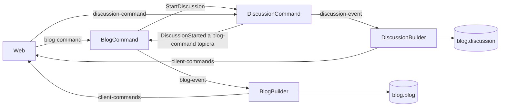

# Blog Quarkus

[English documentation](README.md)

A `rapids` Java 21 és Quarkus 3.39.5 alapú átirata. Blogbejegyzéseket,
automatikusan létrejövő beszélgetéseket és többszintű hozzászólásokat kezel.
Az eredeti `rapids` forráskódja változatlan marad; a MongoDB-ben a meglévő
blog- és beszélgetéskollekciókat használjuk.

## Felépítés

A projekt Maven-modulokra bontva követi az eredeti szolgáltatáshatárokat:

| Modul | Feladat |
| --- | --- |
| `config` | MongoDB-kapcsolat és konfiguráció |
| `common` | Parancsok, események, tárolóinterfészek és közös infrastruktúra |
| `pekko-persistence` | Pekko 1.5.0 ActorSystem, perzisztens actorok, Mongo journal és szerializálás |
| `web-common` | Hitelesítés, HTML-megjelenítés és CSS/JavaScript |
| `blog-store`, `discussion-store` | A megfelelő MongoDB-kollekciók elérése, nézetépítő nélkül is |
| `blog-command`, `discussion-command` | Parancsellenőrzés, `BlogActor` és `DiscussionActor` |
| `blog-query-builder`, `discussion-query-builder` | Eseményekből MongoDB-nézetek építése |
| `blog-query`, `discussion-query` | A megfelelő kollekciók HTTP-lekérdezése |
| `web` | Belépés, parancsküldés, dinamikus navigáció és WebSocket-frissítések |
| `monitor` | Monitor HTTP- és WebSocket-végpontok |
| `app` | A modulokat összeállító, futtatható Quarkus alkalmazás |
| `apps/*` | Nyolc, külön futtatható Quarkus alkalmazás a szolgáltatásokhoz |

A parancskezelők közös interfészekre támaszkodnak, nem a nézetépítő vagy
lekérdező modulok osztályaira. Kafka módban ugyanaz az üzenetfolyam kapcsolja
össze a modulokat egyetlen JVM-ben és külön szolgáltatásokban is:



A nézetek a `blog.blog` és `blog.discussion` kollekciókba kerülnek,
az eredeti `_id`, `discussions` és beágyazott `comments` szerkezettel.
A command állapotot az eredetihez hasonlóan Pekko Persistence kezeli. A
`CommandService` azonosítónként külön `BlogActor` vagy `DiscussionActor`
példányt hoz létre, figyeli a leállását, és tíz perc inaktivitás után elengedi.
A persistence ID-k változatlanok: `blog-<id>` és `discussion-<id>`. Az actor
a journal visszajátszásával állítja vissza az állapotát; a command modulok
nem olvasnak állapotot a lekérdezési kollekciókból.

Mongo módban az eredeti `pekko-persistence-mongodb_2.13:1.5.0` plugin
dolgozik, alapértelmezetten a `store.pekko_persistence_journal` és
`store.pekko_persistence_snaps` kollekciókkal. Ez a Pekko belső journalja;
a lekérdezési adatok továbbra is külön a `blog.blog` és `blog.discussion`
kollekciókban vannak. A nézetépítők saját Kafka-offsetjük szerint folytatják
a feldolgozást. A command actor csak sikeres perzisztálás és állapotfrissítés
után válaszol; közben a Pekko sorba állítja a következő parancsokat.

Az eseményszerializáló megtartja az eredeti `0xfecb` azonosítót, a UTF-8 JSON
formátumot, a `_t` típusjelölést és a régi `CommentAdded.index` olvasását.
A korábbi Scala snapshotok eltérő osztályai miatt alapértelmezetten teljes
journal-visszajátszás történik. A `snap` actorüzenettel új Java snapshot
menthető; ezek használata `BLOG_PEKKO_SNAPSHOTS_ENABLED=true` értékkel
engedélyezhető. Régi, Java/Scala alapértelmezett szerializálással mentett
snapshotok közvetlen kompatibilitását ez nem garantálja.

Az `app-dc.yml` az összesítő `app` modulból épített alkalmazást indítja.
A `ms-dc.yml` az `apps/*` külön futtatható csomagjait indítja HAProxy mögött.
Egy szolgáltatáspéldányt futtass szerepenként, és válassz a két indítási mód
közül: ugyanazon Kafka/MongoDB fölött ne futtasd egyszerre a monolitot és a
külön szolgáltatásokat. A régi Pekko események visszaolvasását a fenti plugin,
persistence ID és szerializáló teszi lehetővé; a meglévő adatbázissal ezt
futtatáskor is ellenőrizni kell. A korábbi Quarkus-változat saját
`store.blog-command`, `store.discussion-command` és `blog-quarkus.journal`
kollekcióit nem olvassuk command állapotként, és nem alakítjuk át automatikusan.
Az ezekben létrehozott adatok command állapotának átvétele külön migrációt
igényel; a megmaradt lekérdezési dokumentumok továbbra is megjeleníthetők.

### Regisztráció és dinamikus navigáció

A `blog-query`, `discussion-query` és `monitor` induláskor, majd tíz
másodpercenként `FunctionLink` üzenetet küld a Kafka `web-app` topicjára.
Az üzenet az eredeti `order`, `url`, `title` mezők mellett szolgáltatás- és
példányazonosítót, belső címet, lejárati időt és navigációs jelzőt tartalmaz.
A blog és monitor menüpontként jelenik meg; a beszélgetés csak konkrét
azonosítóval nyitható meg, ezért a regisztrációja nem menüpont.

A webmodul regisztrációkból készíti a `Link` fejlécet, a menüt és a
`GET /services` választ. Újrainduláskor új Kafka-fogyasztócsoporttal visszaolvassa
a topicot; a 45 másodperce nem megújított regisztrációkat elhagyja. A böngésző
tíz másodpercenként frissíti a menüt. Első induláskor néhány másodperc kellhet,
amíg a szolgáltatások megjelennek.

Ez az eredetihez hasonló dinamikus funkciófelfedezés. A HTTP-prefixek
továbbítása továbbra is rögzített a `haproxy/haproxy.cfg` fájlban; új
szolgáltatás dinamikus proxyútvonalának felvétele nincs ebben a lépésben.

### Kafka-fogyasztócsoportok

| Szerep | Topic | Fogyasztócsoport |
| --- | --- | --- |
| Blog parancskezelő | `blog-command` | `blog-command` |
| Beszélgetés parancskezelő | `discussion-command` | `discussion-command` |
| Blog nézetépítő | `blog-event` | `blog-query` |
| Beszélgetés nézetépítő | `discussion-event` | `discussion-query` |
| Regisztrációs nyilvántartás | `web-app` | Új, példányonkénti `webapp-registry-*` |
| WebSocket értesítések | `client-commands` | Példányonkénti `webapp-updates-*` |
| Monitor | `performance` | Példányonkénti `monitor-performance-*` |

A feldolgozó csak a sikeresen kezelt rekord offsetjét nyugtázza. Átmeneti
tárolási vagy továbbítási hibánál újrapróbálja a rekordot. A hibás parancs az
`error` topicra és az érintett klienshez kerül. A parancsok `_requestId`
azonosítója megakadályozza a már eltárolt kérés megismételt végrehajtását;
a nézetépítők az ismételt létrehozási és hozzászólási eseményeket is kezelik.
Kafka nélkül ugyanezek a topic-kezelők helyi üzenetbuszon működnek, kizárólag
az összesítő alkalmazásban.

## Előfeltételek

- Java/JDK 21 és Maven 3.9.x a csomagoláshoz.
- Podman és Compose szolgáltató, például `podman-compose`.
- Internetelérés a Maven-függőségek és a konténerképek letöltéséhez.
- `openssl` a helyi tokenaláíró kulcs létrehozásához.

A `podman compose` egy külső Compose szolgáltatót használ. Ha a gépen több
szolgáltató van, kiválasztható például így:

```bash
export PODMAN_COMPOSE_PROVIDER=podman-compose
```

A Compose fájlok `x-podman.in_pod: false` beállítása külön konténerekre és
közös Compose-hálózatra állítja a szolgáltatásokat. Ez szükséges a Kafka
`keep-id` felhasználói névteréhez: a Podman nem engedi a `--userns` és
`--pod` opciókat együtt használni. Ne írd felül ezt `--in-pod true` kapcsolóval.

Minden alábbi parancsot a `blog-quarkus` könyvtárban futtass.

## Teljes alkalmazás indítása Podmannel

1. Hozd létre a helyi környezeti beállításokat egyszer:

   ```bash
   cp .env.example .env
   printf '\nBLOG_AUTH_SECRET=%s\n' "$(openssl rand -hex 32)" >> .env
   chmod 600 .env
   ```

   A `.env` kimarad a Gitből. A `BLOG_AUTH_SECRET` legalább 32 karakteres legyen;
   újraindítások között tartsd meg, hogy a korábban kiadott tokenek érvényesek
   maradjanak. A portokat a `.env` fájlban módosíthatod, ha például az eredeti
   `rapids` Kafka vagy MongoDB példánya már használja őket.

2. Készítsd el a Quarkus fast-jar csomagot, tesztfuttatás nélkül:

   ```bash
   mvn -DskipTests package
   ```

   A konténerkép a teljes `modules/app/target/quarkus-app/` könyvtárat használja, nem
   csak a `quarkus-run.jar` fájlt. A `Containerfile` a már elkészült Maven
   csomagot másolja be; nem fordít újra.

3. Indítsd el a teljes összeállítást:

   ```bash
   mkdir -p ~/kafkadata ~/mongodbdata
   podman compose --env-file .env -p blog-quarkus -f infra-dc.yml -f app-dc.yml up -d --build
   ```

   Az alkalmazás a Kafka és a MongoDB sikeres állapotellenőrzése után indul.
   A Kafka KRaft módban fut, ZooKeeper nélkül. A szükséges topicok az első
   használatkor automatikusan létrejönnek.

Az alkalmazás alapértelmezett címe: **http://localhost:8090/blog**.

## Külön szolgáltatások indítása Podmannel

A `.env` és az adatkönyvtárak ugyanazok, mint az egyfolyamatos futtatásnál.
Minden szolgáltatás ugyanazt a `BLOG_AUTH_SECRET` értéket kapja, így a web
által kiadott tokent a külön parancskezelők is ellenőrizhetik.

Ha jelenleg a monolit fut, először állítsd le:

```bash
podman compose --env-file .env -p blog-quarkus -f infra-dc.yml -f app-dc.yml down
```

Majd csomagold és indítsd az önálló szolgáltatásokat:

```bash
mvn -DskipTests package
podman compose --env-file .env -p blog-quarkus -f infra-dc.yml -f ms-dc.yml up -d --build
```

A gateway címe változatlanul **http://localhost:8090**. A HAProxy a `/blog`,
`/discussion` és `/monitor` prefixeket a megfelelő szolgáltatáshoz, a többi
kérést a webmodulhoz továbbítja. A WebSocket útvonalak is ezen a címen működnek.
A belső szolgáltatásportok nincsenek publikálva a gazdagépre.

| Önálló alkalmazás | Könyvtár | Belső/default HTTP-port |
| --- | --- | --- |
| Web | `apps/web` | 8081 |
| Blog lekérdezés | `apps/blog-query` | 8082 |
| Beszélgetés lekérdezés | `apps/discussion-query` | 8083 |
| Monitor | `apps/monitor` | 8084 |
| Blog parancskezelő | `apps/blog-command` | 8085 |
| Beszélgetés parancskezelő | `apps/discussion-command` | 8086 |
| Blog nézetépítő | `apps/blog-query-builder` | 8087 |
| Beszélgetés nézetépítő | `apps/discussion-query-builder` | 8088 |

A parancskezelő és nézetépítő alkalmazások feladata a Kafka-fogyasztás;
a bejegyzések parancsvégpontja a webmodulban van.

Egyetlen szolgáltatás külön frissítése, illetve leállítása:

```bash
podman compose --env-file .env -p blog-quarkus -f infra-dc.yml -f ms-dc.yml up -d --build --no-deps --force-recreate blog-query
podman compose --env-file .env -p blog-quarkus -f infra-dc.yml -f ms-dc.yml stop blog-query
```

Teljes leállítás, az adatok megtartásával:

```bash
podman compose --env-file .env -p blog-quarkus -f infra-dc.yml -f ms-dc.yml down
```

## Egy szolgáltatás indítása Java/Maven segítségével

Az infrastruktúra fusson, és az összesítő alkalmazás megfelelő parancs- vagy
nézetépítő szerepe ne fusson ugyanazon fogyasztócsoporttal párhuzamosan.
Csomagolás után például:

```bash
java -jar apps/blog-query/target/quarkus-app/quarkus-run.jar
```

Ez a blog lekérdezőt indítja a **http://localhost:8082/blog** címen, saját
MongoDB-olvasóval és regisztrációval; nézetépítő vagy parancskezelő nem indul
vele együtt. A többi alkalmazás ugyanígy indítható a táblázat szerinti
könyvtárból származó `quarkus-run.jar` fájllal. Mindig a projekt gyökeréből
indítsd, hogy a `.env` beállításai elérhetők legyenek. A gateway mögötti
felület a teljes `/login`, `/commands`, `/updates` funkciókat is biztosítja;
a közvetlen szolgáltatáscím elsősorban külön futtatásra és diagnosztikára való.

Fejlesztői módban:

```bash
mvn -DskipTests install
mvn -pl apps/blog-query quarkus:dev
```

A `KAFKA_PORT` és `MONGO_PORT` helyi portfelülírásokat az önálló alkalmazások
is használják. A `BLOG_KAFKA_BOOTSTRAP_SERVERS` és `BLOG_MONGO_URI`
beállításokkal teljes címek is megadhatók.

| Szolgáltatás | Cím a gazdagépről | Cím a Compose hálózatán |
| --- | --- | --- |
| Quarkus / gateway | `http://localhost:8090` | `app:8080` vagy `gateway:8080` |
| Kafka | `localhost:9094` | `kafka:9092` |
| MongoDB | `mongodb://localhost:27017` | `mongodb://mongodb:27017` |

A publikált portok a helyi gép `127.0.0.1` címéhez kötődnek. A belső Kafka
listener a `kafka` szolgáltatásnevet hirdeti; a külső listener a gazdagép
`localhost` címét. A `.env` portfelülírása a hirdetett Kafka-portot is módosítja.

### Belépés helyi futtatáshoz

Az összeállítás helyi demonstrációhoz bekapcsolja a `BLOG_AUTH_DEV_LOGIN`
beállítást: a Basic felhasználónév és jelszó azonos, például `john:john`.
Ez az alkalmazás meglévő fejlesztői belépési módja.

A böngészőben kattints a **Belépés** gombra, és add meg például a `john` / `john`
adatokat. Az **Új bejegyzés** oldalon töltsd ki a címet és a Markdown-tartalmat,
majd nyomd meg a **Mentés** gombot. Ha még nem léptél be, a mentés megnyitja a
belépési ablakot. Sikeres mentés után a bejegyzés oldala jelenik meg. A token
a böngészőfül munkamenetében marad; lejáratkor újra be kell lépni. A hibák az
űrlapon jelennek meg, a beírt szöveg megtartásával.

```bash
curl -i -X POST -u john:john http://localhost:8090/login
```

A válasz `X-Token` fejlécében kapott token a további parancsokhoz
`Authorization: Bearer <token>` formában használható. A token öt percig
érvényes, és a sikeres parancsválasz friss tokent ad vissza. Megosztott vagy
éles környezethez kapcsold ki a demonstrációs belépést, és állíts be külön
hitelesítést; az összeállítás helyi fejlesztésre készült.

Kafka módban a parancsvégpont **202 Accepted** választ ad: a parancs sorba
került, de a nézet még nem feltétlenül készült el. A böngésző megvárja a
nézet frissülését, és a `client-commands` topicról érkező WebSocket hibákat
is megjeleníti. Azonos tartalmú újrapróbáláskor megtartja a kérésazonosítót.

## Csak az infrastruktúra Podmanben

```bash
podman compose -p blog-quarkus -f infra-dc.yml up -d
```

Ezután a Quarkus fejlesztői módban a gazdagépen futtatható. A `.env` fájlban
megadott értékeket az alábbi példában add át környezeti változóként is:

A fejlesztői mód első indítása előtt telepítsd a modulokat a helyi Maven-tárba:

```bash
mvn -DskipTests install
```

```bash
BLOG_STORE=mongo \
BLOG_MONGO_URI=mongodb://localhost:27017 \
BLOG_KAFKA_ENABLED=true \
BLOG_KAFKA_BOOTSTRAP_SERVERS=localhost:9094 \
mvn -pl modules/app quarkus:dev
```

Ebben a módban az alkalmazás címe **http://localhost:8080/blog**. A gazdagépen
futó alkalmazás a külső Kafka-portot használja. Ha a `.env` fájlban más
`MONGO_PORT` vagy `KAFKA_PORT` érték van, a fenti címeket is módosítsd.
Az alkalmazáskonténert és a gazdagépen futó alkalmazást ne futtasd egyszerre
ugyanazzal az eseménynaplóval.

### Csak MongoDB, Kafka nélkül

Az `infra-dc.yml` helyett:

```bash
podman compose -p blog-quarkus -f mongo-dc.yml up -d
BLOG_STORE=mongo \
BLOG_MONGO_URI=mongodb://localhost:27017 \
BLOG_KAFKA_ENABLED=false \
mvn -pl modules/app quarkus:dev
```

A HTTP-parancsok és a WebSocket értesítések Kafka nélkül is működnek.
A `mongo-dc.yml` és az `infra-dc.yml` ugyanazzal a projektnévvel ugyanazt a
MongoDB-adatkönyvtárat használja; egymás alternatívái.

### Konténerek nélkül

```bash
mvn -DskipTests install
mvn -pl modules/app quarkus:dev
```

Alapértelmezett fejlesztői módban a Kafka ki van kapcsolva, az események
a Pekko LevelDB journalba (`data/pekko-journal`) kerülnek, a snapshotok a
`data/pekko-snapshots` könyvtárba; a nézeteket a `data/blog.json` és `data/discussion.json`
fájlok tárolják. A demonstrációs belépés elérhető.

## Naplók, frissítés és leállítás

```bash
podman compose -p blog-quarkus -f infra-dc.yml -f app-dc.yml ps
podman compose -p blog-quarkus -f infra-dc.yml -f app-dc.yml logs -f app
```

Forrásmódosítás után:

```bash
mvn -DskipTests package
podman compose -p blog-quarkus -f infra-dc.yml -f app-dc.yml up -d --build
```

Leállítás a tárolt adatok megtartásával:

```bash
podman compose -p blog-quarkus -f infra-dc.yml -f app-dc.yml down
```

A Kafka a `~/kafkadata` könyvtárat a `/var/lib/kafka/data` útvonalra, a MongoDB
a `~/mongodbdata` könyvtárat a `/data/db` útvonalra csatolja. Más könyvtárakhoz
add meg a `.env` fájlban a `KAFKA_DATA_DIR` és `MONGO_DATA_DIR` abszolút
útvonalait. A `:z` csatolási opció az SELinux címkézést biztosítja; nem állítja
át automatikusan a fájlok tulajdonosát. A Kafka rootless Podmanhez beállított
`keep-id` felhasználói névtere a gazdagép felhasználóját a konténerbeli
1000-es UID/GID-re képezi, így a saját könyvtárába tulajdonosváltás nélkül
írhat. A MongoDB adatkönyvtárát a meglévő Podman felhasználói leképezéssel
használjuk.

Meglévő Kafka-adatkönyvtár esetén a `.env` `KAFKA_CLUSTER_ID` értéke egyezzen
a könyvtár `meta.properties` fájljának `cluster.id` értékével. A konfiguráció
nem törli és nem formázza újra a meglévő adatokat. Ugyanazt az adatkönyvtárat
egyszerre csak egy Kafka, illetve MongoDB példány használhatja: állítsd le a
korábbi példányt, mielőtt az új csatolásokkal elindítod az alkalmazást.

A MongoDB-adatbázis neve a `.env` `BLOG_MONGO_DATABASE` beállításával adható
meg; alapértelmezése `blog`. A parancsesemények adatbázisát külön a
`BLOG_MONGO_COMMAND_DATABASE` állítja, alapértelmezése `store`. A meglévő
Rapids `blog.blog` és `blog.discussion` dokumentumai közvetlenül használhatók.
Ha a `.env` fájlban még `BLOG_MONGO_DATABASE=blog-quarkus` van, állítsd `blog`-ra
az eredeti nézetek eléréséhez. A korábbi, összevont Quarkus változat
`blog-quarkus.journal` kollekcióját nem töröljük és nem alakítjuk át
automatikusan; az ott létrehozott bejegyzések átvétele külön migrációt igényel.

A MongoDB-kép alapértelmezése `docker.io/library/mongo:8.2`, mert a meglévő
adatkönyvtár `featureCompatibilityVersion` értéke 8.2. A `MONGO_IMAGE`
környezeti változóval felülírható. A 8.0-s szerver ezeket az adatokat nem
tudja megnyitni: `Wrong mongod version` hibával és 62-es kilépési kóddal
leáll. Ilyenkor az alkalmazás a MongoDB `healthy` állapotára vár. A javítás
a megfelelő verziójú szerver indítása; az adatkönyvtár törlése vagy a
kompatibilitási metaadat kézi átírása nem szükséges.

Ha korábban a névvel ellátott kötetekkel indítottad ezt a projektet, a bennük
létrehozott új adatok a régi kötetekben maradnak. Ezeket nem töröljük; a bind
csatolásokra váltás előtt az onnan szükséges adatokat külön át kell vinni.

A csatolások módosítása után állítsd le, majd hozd létre újra a konténereket:

```bash
podman compose --env-file .env -p blog-quarkus -f infra-dc.yml -f app-dc.yml down
mvn -DskipTests package
podman compose --env-file .env -p blog-quarkus -f infra-dc.yml -f app-dc.yml up -d --build --force-recreate
```

A korábbi kötetek így megmaradnak. A frissített CSS és JavaScript betöltéséhez
frissítsd a böngészőoldalt `Ctrl+Shift+R` billentyűkkel.

## Kafka topicok megtekintése

```bash
podman compose -p blog-quarkus -f infra-dc.yml exec kafka \
  /opt/kafka/bin/kafka-topics.sh --bootstrap-server kafka:9092 --list

podman compose -p blog-quarkus -f infra-dc.yml exec kafka \
  /opt/kafka/bin/kafka-console-consumer.sh \
  --bootstrap-server kafka:9092 --topic blog-event \
  --from-beginning --property print.key=true
```

Használt topicok: `blog-command`, `discussion-command`, `blog-event`,
`discussion-event`, `client-commands`, `error`, `web-app`, `performance`.
Az alkalmazások másodpercenként küldenek feldolgozási számlálókat a
`performance` topicra; a monitor az élő példányok adatait mutatja. A korábbi
`user` topicot ez az átirat jelenleg nem használja.

A Monitor `commands` és `events` értékei a sikeresen feldolgozott command-
és eventüzenetek számlálói; egyszerű oldalmegnyitás nem növeli őket. Külön
szolgáltatásoknál a Monitor a legfeljebb 45 másodperces metrikákat összegzi,
saját számlálóit csak egyszer számolja. A `blogs` és `discussions` értékek
a megfelelő nézetkollekciók aktuális dokumentumszámai. A böngésző
másodpercenként kéri a friss statisztikát.

## Végpontok

| Végpont | Funkció |
| --- | --- |
| `GET /blog` | Bloglista |
| `GET /blog/new`, `GET /blog/{id}/edit` | Új bejegyzés és szerkesztés |
| `GET /blog/{id}` | Bejegyzés és beszélgetéseinek linkjei |
| `GET /discussion/{id}` | Beszélgetés és hozzászólásfa |
| `GET /discussion/{id}/new` | Új hozzászólás |
| `GET /discussion/{id}/comment/{commentId}/new` | Válasz egy hozzászólásra |
| `POST /login` | Belépés és tokenkiadás |
| `POST /commands/{topic}/{id}` | `_t` mezős JSON-parancs; a topic `blog` vagy `discussion` |
| `GET /services` | Az élő HTTP-szolgáltatások regisztrációi |
| `GET /monitor` | Az alkalmazás számlálói |
| `/updates/{id}?token=<token>` | A hitelesített felhasználó WebSocket értesítései |
| `/monitor/ws` | Monitor WebSocket; kapcsolódáskor és üzenetre ad állapotot |

A lekérdezési végpontok az `Accept: application/json` fejléc esetén JSON-t,
egyébként HTML-t adnak. A hozzászólások és bejegyzések tartalma Markdownként
kerül megjelenítésre.

## Hivatkozások

- [Podman Compose szolgáltatók](https://docs.podman.io/en/latest/markdown/podman-compose.1.html)
- [Apache Kafka konténerképek](https://kafka.apache.org/41/getting-started/docker/)
- [Quarkus Maven csomagolás](https://quarkus.io/guides/maven-tooling)
- [Quarkus környezeti konfiguráció](https://quarkus.io/guides/config-reference/)
- [Podman felhasználói névterek és bind csatolások](https://docs.podman.io/en/latest/markdown/podman-run.1.html)
- [MongoDB 8.2 kiadási dokumentáció](https://www.mongodb.com/docs/manual/release-notes/8.2/)
- [HAProxy 3.2 konfiguráció](https://docs.haproxy.org/3.2/configuration.html)
