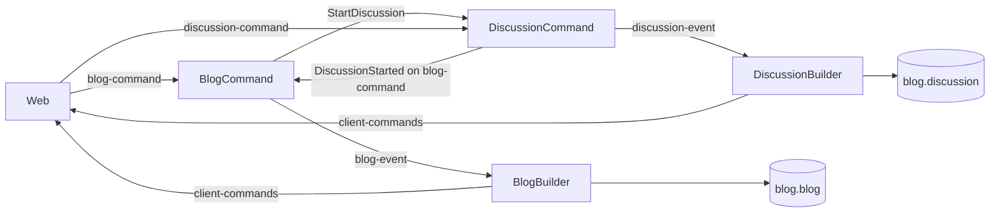

# Blog Quarkus

[Magyar dokumentáció](README-HU.md)

A Java 21 and Quarkus 3.39.5 port of `rapids`. It supports blog posts,
automatically created discussions, and nested comments. The original `rapids`
source code remains unchanged; the application uses the existing blog and
discussion collections in MongoDB.

## Architecture

The Maven modules follow the original service boundaries:

| Module | Responsibility |
| --- | --- |
| `config` | MongoDB connection and configuration |
| `common` | Commands, events, storage interfaces, and shared infrastructure |
| `pekko-persistence` | Pekko 1.5.0 ActorSystem, persistent actors, Mongo journal, and serialization |
| `web-common` | Authentication, HTML rendering, and CSS/JavaScript |
| `blog-store`, `discussion-store` | Access to the corresponding MongoDB collections, independently of projection builders |
| `blog-command`, `discussion-command` | Command validation, `BlogActor`, and `DiscussionActor` |
| `blog-query-builder`, `discussion-query-builder` | Building MongoDB projections from events |
| `blog-query`, `discussion-query` | HTTP queries for the corresponding collections |
| `web` | Login, command submission, dynamic navigation, and WebSocket updates |
| `monitor` | Monitor HTTP and WebSocket endpoints |
| `app` | Runnable Quarkus application combining the modules |
| `apps/*` | Eight independently runnable Quarkus service applications |

Command handlers depend on shared interfaces rather than classes from the
projection builder or query modules. With Kafka enabled, the same message flow
connects the modules both within a single JVM and across separate services:



Projections are stored in `blog.blog` and `blog.discussion`, preserving the
original `_id`, `discussions`, and nested `comments` structure.
Pekko Persistence manages command state, as in the original application.
`CommandService` creates a separate `BlogActor` or `DiscussionActor` for each
aggregate ID, watches its termination, and stops it after ten minutes of
inactivity. Persistence IDs remain `blog-<id>` and `discussion-<id>`. Actors
recover their state by replaying the journal; command modules do not load
their state from query collections.

Mongo mode uses the original `pekko-persistence-mongodb_2.13:1.5.0` plugin,
with `store.pekko_persistence_journal` and `store.pekko_persistence_snaps`
as the default collections. This is Pekko's internal journal; query data
remains separate in `blog.blog` and `blog.discussion`. Projection builders
resume processing from their own Kafka offsets. Command actors reply only
after successful persistence and state updates; Pekko queues subsequent
commands while this completes.

The event serializer preserves the original `0xfecb` identifier, UTF-8 JSON
format, `_t` type discriminator, and support for reading the legacy
`CommentAdded.index` field. Recovery replays the full journal by default
because earlier Scala snapshots use different classes. The `snap` actor
message saves a new Java snapshot; loading these snapshots can be enabled
with `BLOG_PEKKO_SNAPSHOTS_ENABLED=true`. This does not guarantee direct
compatibility with older snapshots saved using default Java/Scala serialization.

`app-dc.yml` starts the application built from the combined `app` module.
`ms-dc.yml` starts the separate `apps/*` packages behind HAProxy. Run one
instance per service role and choose one deployment mode: do not run the
monolith and separate services simultaneously against the same Kafka/MongoDB
infrastructure. The plugin, persistence IDs, and serializer described above
allow reading legacy Pekko events; this still needs runtime verification with
the existing database. The custom `store.blog-command`,
`store.discussion-command`, and `blog-quarkus.journal` collections from earlier
Quarkus versions are not read as command state or migrated automatically.
Importing their command state requires a separate migration; the remaining
query documents can still be displayed.

### Registration and dynamic navigation

`blog-query`, `discussion-query`, and `monitor` publish a `FunctionLink`
message to the Kafka `web-app` topic at startup and every ten seconds.
In addition to the original `order`, `url`, and `title` fields, the message
contains service and instance identifiers, an internal address, an expiration
time, and a navigation flag. Blog and Monitor appear as menu entries.
Discussions require a specific ID, so their registration is not a menu entry.

The web module builds the `Link` header, navigation menu, and `GET /services`
response from these registrations. On restart, it replays the topic using a
new Kafka consumer group. Registrations that have not been renewed for 45
seconds are removed. The browser refreshes the menu every ten seconds.
Services may take a few seconds to appear after the initial startup.

This provides dynamic feature discovery similar to the original application.
HTTP prefix routing remains fixed in `haproxy/haproxy.cfg`; dynamically
adding proxy routes for new services is not part of this implementation step.

### Kafka consumer groups

| Role | Topic | Consumer group |
| --- | --- | --- |
| Blog command handler | `blog-command` | `blog-command` |
| Discussion command handler | `discussion-command` | `discussion-command` |
| Blog projection builder | `blog-event` | `blog-query` |
| Discussion projection builder | `discussion-event` | `discussion-query` |
| Service registry | `web-app` | New per-instance `webapp-registry-*` |
| WebSocket notifications | `client-commands` | Per-instance `webapp-updates-*` |
| Monitor | `performance` | Per-instance `monitor-performance-*` |

Processors commit only the offset of a successfully handled record. Transient
storage or delivery failures cause the record to be retried. Invalid commands
are sent to the `error` topic and the affected client. The `_requestId`
command identifier prevents repeated execution of an already persisted
request; projection builders also handle repeated creation and comment events.
Without Kafka, the same topic handlers use a local message bus, available
only in the combined application.

## Prerequisites

- Java/JDK 21 and Maven 3.9.x for packaging.
- Podman and a Compose provider such as `podman-compose`.
- Internet access to download Maven dependencies and container images.
- `openssl` to generate the local token signing key.

`podman compose` uses an external Compose provider. If several providers are
installed, select one explicitly, for example:

```bash
export PODMAN_COMPOSE_PROVIDER=podman-compose
```

The Compose files set `x-podman.in_pod: false` to run services in separate
containers on a shared Compose network. This is required for Kafka's
`keep-id` user namespace: Podman does not allow `--userns` and `--pod`
together. Do not override this with `--in-pod true`.

Run all commands below from the `blog-quarkus` directory.

## Running the complete application with Podman

1. Create the local environment configuration once:

   ```bash
   cp .env.example .env
   printf '\nBLOG_AUTH_SECRET=%s\n' "$(openssl rand -hex 32)" >> .env
   chmod 600 .env
   ```

   `.env` is excluded from Git. `BLOG_AUTH_SECRET` must contain at least 32
   characters. Keep it unchanged between restarts so previously issued tokens
   remain valid. Change the ports in `.env` if, for example, the original
   `rapids` Kafka or MongoDB instance already uses them.

2. Build the Quarkus fast-jar package without running tests:

   ```bash
   mvn -DskipTests package
   ```

   The container image uses the entire `modules/app/target/quarkus-app/`
   directory, not just `quarkus-run.jar`. The `Containerfile` copies the
   existing Maven package; it does not compile the application again.

3. Start the complete stack:

   ```bash
   mkdir -p ~/kafkadata ~/mongodbdata
   podman compose --env-file .env -p blog-quarkus -f infra-dc.yml -f app-dc.yml up -d --build
   ```

   The application starts after Kafka and MongoDB pass their health checks.
   Kafka runs in KRaft mode without ZooKeeper. Required topics are created
   automatically on first use.

The default application URL is **http://localhost:8090/blog**.

## Running separate services with Podman

The `.env` file and data directories are the same as for the single-process
deployment. Every service receives the same `BLOG_AUTH_SECRET`, allowing
separate command handlers to verify tokens issued by the web module.

If the monolith is running, stop it first:

```bash
podman compose --env-file .env -p blog-quarkus -f infra-dc.yml -f app-dc.yml down
```

Then package and start the standalone services:

```bash
mvn -DskipTests package
podman compose --env-file .env -p blog-quarkus -f infra-dc.yml -f ms-dc.yml up -d --build
```

The gateway URL remains **http://localhost:8090**. HAProxy routes the `/blog`,
`/discussion`, and `/monitor` prefixes to their corresponding services and
all other requests to the web module. WebSocket routes also use this address.
Internal service ports are not published to the host.

| Standalone application | Directory | Internal/default HTTP port |
| --- | --- | --- |
| Web | `apps/web` | 8081 |
| Blog query | `apps/blog-query` | 8082 |
| Discussion query | `apps/discussion-query` | 8083 |
| Monitor | `apps/monitor` | 8084 |
| Blog command handler | `apps/blog-command` | 8085 |
| Discussion command handler | `apps/discussion-command` | 8086 |
| Blog projection builder | `apps/blog-query-builder` | 8087 |
| Discussion projection builder | `apps/discussion-query-builder` | 8088 |

Command handler and projection builder applications consume Kafka messages.
The HTTP endpoint for submitting commands belongs to the web module.

Update or stop a single service independently:

```bash
podman compose --env-file .env -p blog-quarkus -f infra-dc.yml -f ms-dc.yml up -d --build --no-deps --force-recreate blog-query
podman compose --env-file .env -p blog-quarkus -f infra-dc.yml -f ms-dc.yml stop blog-query
```

Stop the complete stack while preserving data:

```bash
podman compose --env-file .env -p blog-quarkus -f infra-dc.yml -f ms-dc.yml down
```

## Running a single service with Java/Maven

The infrastructure must be running. Do not run the corresponding command or
projection builder role of the combined application concurrently using the
same consumer group. After packaging, for example:

```bash
java -jar apps/blog-query/target/quarkus-app/quarkus-run.jar
```

This starts the blog query service at **http://localhost:8082/blog**, with its
own MongoDB reader and service registration. No projection builder or command
handler starts alongside it. Start the other applications in the same way,
using `quarkus-run.jar` from the directories listed above. Always launch from
the project root so `.env` settings are available. The gateway also provides
the complete `/login`, `/commands`, and `/updates` functionality; direct
service addresses are primarily for independent execution and diagnostics.

For development mode:

```bash
mvn -DskipTests install
mvn -pl apps/blog-query quarkus:dev
```

Standalone applications also honor local port overrides through `KAFKA_PORT`
and `MONGO_PORT`. Use `BLOG_KAFKA_BOOTSTRAP_SERVERS` and `BLOG_MONGO_URI`
to specify complete addresses.

| Service | Host address | Compose network address |
| --- | --- | --- |
| Quarkus / gateway | `http://localhost:8090` | `app:8080` or `gateway:8080` |
| Kafka | `localhost:9094` | `kafka:9092` |
| MongoDB | `mongodb://localhost:27017` | `mongodb://mongodb:27017` |

Published ports bind to the host's `127.0.0.1` address. Kafka's internal
listener advertises the `kafka` service name; the external listener advertises
the host's `localhost` address. A port override in `.env` also changes the
advertised Kafka port.

### Login for local development

The stack enables `BLOG_AUTH_DEV_LOGIN` for local demonstration: the Basic
username and password must be identical, for example `john:john`. This is the
application's existing development login mode.

In the browser, click **Belépés** (Login) and enter, for example, `john` / `john`.
On the **Új bejegyzés** (New post) page, enter the title and Markdown content,
then click **Mentés** (Save). If you are not logged in, saving opens the login
dialog. After a successful save, the post page appears. The token remains in
the browser tab's session; log in again when it expires. Errors appear on the
form without discarding the entered text.

```bash
curl -i -X POST -u john:john http://localhost:8090/login
```

Use the token from the response's `X-Token` header for subsequent commands
as `Authorization: Bearer <token>`. Tokens are valid for five minutes, and a
successful command response returns a fresh token. For shared or production
environments, disable demonstration login and configure separate
authentication; this stack is intended for local development.

With Kafka enabled, the command endpoint returns **202 Accepted**: the command
has been queued, but its projection may not yet be ready. The browser waits
for the projection to update and also displays WebSocket errors received from
the `client-commands` topic. Retrying the same content preserves the request ID.

## Running only the infrastructure in Podman

```bash
podman compose -p blog-quarkus -f infra-dc.yml up -d
```

Quarkus can then run in development mode on the host. In the example below,
also pass the values configured in `.env` as environment variables.

Before starting development mode for the first time, install the modules in
the local Maven repository:

```bash
mvn -DskipTests install
```

```bash
BLOG_STORE=mongo \
BLOG_MONGO_URI=mongodb://localhost:27017 \
BLOG_KAFKA_ENABLED=true \
BLOG_KAFKA_BOOTSTRAP_SERVERS=localhost:9094 \
mvn -pl modules/app quarkus:dev
```

In this mode, the application URL is **http://localhost:8080/blog**. The
application on the host uses the external Kafka port. If `.env` specifies
different `MONGO_PORT` or `KAFKA_PORT` values, adjust the addresses above.
Do not run the application container and the host application simultaneously
against the same event journal.

### MongoDB only, without Kafka

Instead of `infra-dc.yml`:

```bash
podman compose -p blog-quarkus -f mongo-dc.yml up -d
BLOG_STORE=mongo \
BLOG_MONGO_URI=mongodb://localhost:27017 \
BLOG_KAFKA_ENABLED=false \
mvn -pl modules/app quarkus:dev
```

HTTP commands and WebSocket notifications also work without Kafka.
`mongo-dc.yml` and `infra-dc.yml` use the same MongoDB data directory when
launched with the same project name; they are alternative deployment options.

### Without containers

```bash
mvn -DskipTests install
mvn -pl modules/app quarkus:dev
```

In the default development mode, Kafka is disabled. Events are stored in the
Pekko LevelDB journal (`data/pekko-journal`), snapshots in
`data/pekko-snapshots`, and projections in `data/blog.json` and
`data/discussion.json`. Demonstration login is available.

## Logs, updates, and shutdown

```bash
podman compose -p blog-quarkus -f infra-dc.yml -f app-dc.yml ps
podman compose -p blog-quarkus -f infra-dc.yml -f app-dc.yml logs -f app
```

After changing source code:

```bash
mvn -DskipTests package
podman compose -p blog-quarkus -f infra-dc.yml -f app-dc.yml up -d --build
```

Stop the stack while preserving stored data:

```bash
podman compose -p blog-quarkus -f infra-dc.yml -f app-dc.yml down
```

Kafka mounts `~/kafkadata` at `/var/lib/kafka/data`; MongoDB mounts
`~/mongodbdata` at `/data/db`. To use different directories, set absolute
paths in `.env` with `KAFKA_DATA_DIR` and `MONGO_DATA_DIR`. The `:z` mount
option applies SELinux labeling; it does not automatically change file
ownership. Kafka's `keep-id` user namespace for rootless Podman maps the host
user to UID/GID 1000 inside the container, allowing writes to the user's own
directory without changing ownership. MongoDB uses the existing Podman user
mapping for its data directory.

For an existing Kafka data directory, the `KAFKA_CLUSTER_ID` value in `.env`
must match `cluster.id` in the directory's `meta.properties` file. The
configuration does not delete or reformat existing data. Only one Kafka or
MongoDB instance may use the corresponding data directory at a time. Stop
the previous instance before starting the application with the new mounts.

Set the MongoDB projection database name through `BLOG_MONGO_DATABASE` in
`.env`; the default is `blog`. `BLOG_MONGO_COMMAND_DATABASE` separately
selects the command event database, defaulting to `store`. Existing Rapids
`blog.blog` and `blog.discussion` documents can be used directly. If `.env`
still contains `BLOG_MONGO_DATABASE=blog-quarkus`, change it to `blog` to
access the original projections. The `blog-quarkus.journal` collection from
the earlier combined Quarkus version is not deleted or migrated automatically;
importing posts created there requires a separate migration.

The default MongoDB image is `docker.io/library/mongo:8.2`, matching the
existing data directory's `featureCompatibilityVersion` of 8.2. Override it
with the `MONGO_IMAGE` environment variable. MongoDB 8.0 cannot open this
data: it exits with `Wrong mongod version` and exit code 62. The application
then waits for MongoDB to become `healthy`. Start the matching server version
to resolve this; deleting the data directory or manually changing
compatibility metadata is unnecessary.

If you previously started the project with named volumes, any new data
created there remains in those old volumes. They are not deleted. Transfer
any required data separately before switching to bind mounts.

After changing the mounts, stop and recreate the containers:

```bash
podman compose --env-file .env -p blog-quarkus -f infra-dc.yml -f app-dc.yml down
mvn -DskipTests package
podman compose --env-file .env -p blog-quarkus -f infra-dc.yml -f app-dc.yml up -d --build --force-recreate
```

The previous volumes remain intact. Reload the browser page with
`Ctrl+Shift+R` to load updated CSS and JavaScript.

## Inspecting Kafka topics

```bash
podman compose -p blog-quarkus -f infra-dc.yml exec kafka \
  /opt/kafka/bin/kafka-topics.sh --bootstrap-server kafka:9092 --list

podman compose -p blog-quarkus -f infra-dc.yml exec kafka \
  /opt/kafka/bin/kafka-console-consumer.sh \
  --bootstrap-server kafka:9092 --topic blog-event \
  --from-beginning --property print.key=true
```

Topics used: `blog-command`, `discussion-command`, `blog-event`,
`discussion-event`, `client-commands`, `error`, `web-app`, and `performance`.
Applications publish processing counters to `performance` every second;
Monitor displays metrics for active instances. This port currently does not
use the original `user` topic.

Monitor's `commands` and `events` values count successfully processed command
and event messages; simply opening a page does not increment them. With
separate services, Monitor aggregates metrics no older than 45 seconds and
counts its own counters only once. `blogs` and `discussions` report the
current document counts in the corresponding projection collections. The
browser requests updated statistics every second.

## Endpoints

| Endpoint | Purpose |
| --- | --- |
| `GET /blog` | Blog list |
| `GET /blog/new`, `GET /blog/{id}/edit` | Create and edit posts |
| `GET /blog/{id}` | Post and links to its discussions |
| `GET /discussion/{id}` | Discussion and comment tree |
| `GET /discussion/{id}/new` | New comment |
| `GET /discussion/{id}/comment/{commentId}/new` | Reply to a comment |
| `POST /login` | Login and token issuance |
| `POST /commands/{topic}/{id}` | JSON command with a `_t` field; topic is `blog` or `discussion` |
| `GET /services` | Registrations of active HTTP services |
| `GET /monitor` | Application counters |
| `/updates/{id}?token=<token>` | WebSocket notifications for the authenticated user |
| `/monitor/ws` | Monitor WebSocket; sends status on connection and on incoming messages |

Query endpoints return JSON when the request includes
`Accept: application/json`; otherwise they return HTML. Post and comment
content is rendered as Markdown.

## References

- [Podman Compose providers](https://docs.podman.io/en/latest/markdown/podman-compose.1.html)
- [Apache Kafka container images](https://kafka.apache.org/41/getting-started/docker/)
- [Quarkus Maven packaging](https://quarkus.io/guides/maven-tooling)
- [Quarkus environment configuration](https://quarkus.io/guides/config-reference/)
- [Podman user namespaces and bind mounts](https://docs.podman.io/en/latest/markdown/podman-run.1.html)
- [MongoDB 8.2 release documentation](https://www.mongodb.com/docs/manual/release-notes/8.2/)
- [HAProxy 3.2 configuration](https://docs.haproxy.org/3.2/configuration.html)
